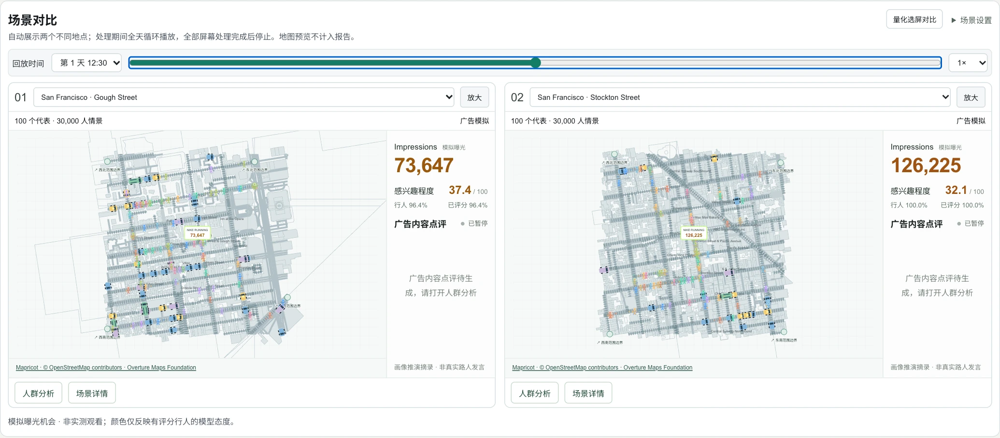

<div align="center">
  

# AI-Native pDOOH World-Model

**面向程序化数字户外广告的全天人群模拟、屏幕投资分析与报价工作台**

Minghao LI · [t330034027@mail.bnbu.edu.cn](mailto:t330034027@mail.bnbu.edu.cn)

[业务流程](#2-四阶段业务流程) · [计算方法](#4-核心指标与数学模型) · [部署运行](#6-安装配置与运行) · [接口与验收](#7-接口交付与验收)

</div>

本文面向媒体策划、广告运营、数据分析及技术实施人员，按八个章节说明当前实现。内容以仓库代码和已保存运行报告为依据；Markdown 无固定纸张，正文按约 7–8 页技术说明的内容量组织，实际打印页数取决于图片、公式及纸张设置。

## 1. 产品定位与业务应用

### 1.1 解决什么问题

pDOOH（programmatic Digital Out-of-Home，程序化数字户外广告）采购通常需要把屏幕清单、位置、媒体价格、广告创意和预算放在一起比较。仅按 CPM 或库存曝光排序，无法说明某个地点的人群是否有机会看到屏幕，也无法解释不同投资侧重点如何改变资金分配。

本项目将这些工作组织为一条可操作的流程：导入库存，准备广告及投放条件，逐屏运行全天场景，汇总模拟证据，计算投资方案，最后生成逐屏报价和 Excel 文件。核心交付是**可追溯的投放规划建议**：每块屏幕对应明确的 ID、地点、观测周期、投放天数、SOT、资金、累计曝光及计算依据。

| 使用角色 | 实际工作 | 系统输出 | 下一步业务动作 |
| --- | --- | --- | --- |
| 媒体策划 | 在预算内比较库存与投放侧重点 | 四种预算分配方案、地图、曝光效率图 | 与广告主确认目标和备选资源 |
| 广告运营 | 核对地点、创意、日期与资金 | 逐屏投资表、日均金额、SOT、Excel | 向 DSP 或媒体方确认可售份额与价格 |
| 数据分析 | 检查模拟证据和效果假设 | 小时回放、态度覆盖、收益情景 | 设计现场验证或投放对照试验 |
| 技术实施 | 接入库存、模型及地图服务 | 项目 API、任务进度、运行记录 | 部署服务、监控任务并保留审计材料 |

适用业务包括区域品牌活动的选屏规划、固定预算下的资源组合比较、创意与场景适配分析，以及小规模试投前的候选筛选。系统目前**不直接连接 DSP 完成竞价或下单**，也不承担广告订单、播放凭证、账单结算和真实归因平台的职责。

### 1.2 当前可用能力

- 库存导入与校验：读取 Excel 工作表，检查 ID、坐标、可售状态、曝光、价格及币种，保留原始记录和排除原因。
- 场景构建与全天模拟：将屏幕映射到街区，生成代表性人群和出行路线，处理行人及车内观看机会，记录 24 个小时的结果。
- 创意分析：结合广告输入与代表画像形成好感、兴趣等模型态度；评分来源及覆盖范围可查。
- 全库存任务管理：显示已处理屏幕数与完成状态；处理期间双场景循环回放，全部完成后开放报告。
- 投资与报价：按不同侧重点分配资金，展示全周期累计 Impression、日均单价、SOT、收益情景及方案差异。



*运行截图：两个不同地点共用回放时间，各自保留场景与统计证据。图中的人群和车流为模拟情景。*

## 2. 四阶段业务流程

### 2.1 数据与设置

访问 `/planning`，上传含 `FilteredFrames` 的 `.xlsx` 文件；界面兼容工作表名称 `filtered_frames`。也可载入仓库的 `data/test.xlsx`，先验证部署和数据链路。

录入总预算、预算币种、开始日期及投放天数，并按业务需要补充地域筛选、汇率、DSP 费率、CPM 加价和单屏限制。规划天数与库存曝光统计周期是两个不同参数：前者决定活动持续多久，后者说明原始 `IMPRESSIONS` 覆盖多少天。未填写明确投放天数时，界面默认以 30 天作预算估算。

### 2.2 广告设置

保存广告活动信息与创意素材，核对地区背景、交通估计和手工输入的车流参数。广告文本、图片和场景资料是模型推演的输入，不能把图片中可见的少量人物直接换算为街区客流。

业务上应先完成创意、目标区域和流量假设确认，再启动批次。改变库存、广告、创意、交通参数或相关文档可能使现有批次与当前输入不再匹配，需要重新生成有效证据。

### 2.3 人群模拟分析

系统对本轮全部屏幕逐一准备地点、人口、路线和广告分析，并记录全天结果。多个屏幕通过后台并行任务处理；前端的 `x / N 块屏幕已处理` 表示后台屏幕处理进度，不表示视频播放进度。

双场景播放器用于观察不同地点的小时演化。拖动到 `23:59` 只改变回放位置，不会自动宣告全库存完成。报告就绪要求每个屏幕具备本轮匹配的完整记录，包括正确的运行引擎、完成状态、24 小时排程和第 1–24 轮快照。旧批次、预览场景和未完成运行不能冒充本轮结果。

### 2.4 报告与投放建议

确认全部屏幕完成后，生成综合报告，检查资金、累计曝光、评分与数据来源。投资地图支持按区域查看投入及单屏依据；分布图把资金分布、曝光分布与单屏散点关系放在一起查看。投资明细、库存评分卡和方案明细均按每页 5 块屏幕分页。

“方案对比”提供综合建议、曝光效率优先、人群兴趣优先、区域分散优先。切换方案后，资金明细、累计曝光及可视化同步更新。最后导出对应策略的 Excel；上线采购前，由运营确认实际价格、最低采购份额、排期和剩余库存。

## 3. 输入契约、数据来源与任务追溯

### 3.1 库存字段

| 字段 | 业务含义与处理要求 |
| --- | --- |
| `VIOOH_ID` | 屏幕唯一 ID；支持 `SCREENID` 等别名。重复 ID 的所有重复行暂不参与投放，不能只取第一条。 |
| `GEOM` | 地理点，常见形式为 `POINT(经度 纬度)`；用于地点解析和一致性检查。 |
| `LATITUDE`、`LONGITUDE` | WGS84 经纬度；需合法且与目标地点一致。地点解析与规划清洗仍会分别检查坐标。 |
| `ADDRESS_*`、`CLOSEST_POI` | 地址、城市、国家及邻近地点，用于检索、显示和区域理解。 |
| `VENUE_TAXONOMY_VALUE` | 场所类型，例如交通、零售或街道环境。 |
| `IMPRESSIONS` | 库存提供的曝光量，必须同时说明统计周期；不默认等于每日曝光。 |
| `FLOORCPM`、`MEDIAOWNERCURRENCY` | 媒体 CPM 及原币种；报价前按输入汇率换算。 |
| `VIOOHSELECTOPTIN` | 可售确认；未确认可售的资源保留记录并给出排除原因。 |
| `FRAMEIMAGEPATH` | 现场图像线索；图片分析还受链接可访问性和视觉模型能力影响。 |

原始行、规范化字段与计算结果分开保留。`SCORE_P` 等原字段可作为参考查看，不应直接被解释为本系统的最终综合评分。缺失值也不等于零：未知态度在重要度计算中可用中性先验，但原始态度列与来源仍需保持未知标记。

### 3.2 统计量的三个层次

| 层次 | 典型数据 | 正确用途 |
| --- | --- | --- |
| 输入证据 | 库存、坐标、现场照片、地域资料、流量参数 | 决定候选范围和模拟条件 |
| 模拟观测 | 实际记录小时数、加权观看机会、好感和兴趣评分 | 比较本轮场景、创意及屏幕差异 |
| 商业测算 | 投放天数、SOT、累计 Impression、资金与 ROI 情景 | 形成预算方案、报价和试投验证计划 |

三层不能混为一个“效果分数”。例如，一个屏幕模拟了 24 小时，输出 30 天预算建议，并不意味着运行了 30 天独立模拟；它是对单日结果按指定周期和 SOT 作线性延展。

### 3.3 批次一致性与落盘

项目签名由库存、广告、创意、交通参数、资料和全天排程等输入生成。报告接口在服务器端重新检查当前批次，再绑定 `campaign_id`、`simulation_batch_id` 和证据指纹，避免客户端随意拼接不同活动的结果。坐标与模拟证据不一致时，不能继续按同一屏幕引用。

主要运行数据位于 `backend/uploads/`：`planning/` 保存项目和覆盖任务，`campaign_experiments/` 保存广告实验，`scene_library/` 保存回放场景。逐屏大体积输入已独立归档，进度状态保持轻量；轮询部分进度时不反复解析所有已完成场景，最终就绪和报告生成仍执行完整校验。

## 4. 核心指标与数学模型

以下符号与当前实现口径对应。$s$ 表示屏幕，$a$ 表示合成代表，$t$ 表示小时，$D$ 表示规划天数，$\alpha_s$ 表示屏幕 SOT，$B$ 表示总预算。

### 4.1 策略驱动的注意力决策

快速模式先为每个代表生成策略参数，再由本地算法执行全天演化。参数包括基础注意概率 $p_a$、兴趣概率、期望停留时间、疲劳系数 $f_a$ 和同伴影响系数 $\beta_a$。

当代表与屏幕存在视线且可观看时间 $\tau_{a,t}>0$ 时：

$$
p_{a,t}=\operatorname{clip}_{[0,1]}\left(
\frac{p_a\min(1,\tau_{a,t}/5)}{1+f_a n_{a,t}}
+\beta_a q_{a,t}\right).
$$

其中 $n_{a,t}$ 为此前产生关注的累计次数，$q_{a,t}$ 为上一轮同屏其他代表的关注比例。没有视线或可用时间时，决策为经过；没有出行或路线不接触屏幕时，分别记录缺席或未曝光。停留时间受可用时间上限约束，随后区分短暂瞥视、观看和兴趣反应。

随机数由种子、代表 ID 和轮次确定。固定策略、场景和种子有利于复现本地轨迹；如果重新调用模型生成策略，结果仍可能变化。`policy_simulation_v1` 是明确标注的方法版本，不等同于逐小时、逐人独立调用语言模型。

### 4.2 全周期累计 Impression

设屏幕在 $H_s$ 个模拟小时内记录的加权机会总量为 $O_s$。事件权重反映代表人口或车内机会规模，而不是画面上图标的数量：

$$
O_s=\sum_{e\in\mathcal E_s}w_e,\qquad
\widehat I_s=O_s\frac{24}{H_s}D\alpha_s.
$$

$\widehat I_s$ 是建议 SOT 下整个规划周期的累计机会。表格中的 `recommended_exposures` 已完成天数和 SOT 折算，前端不应再次乘以 $D$。原始观测总量与小时数单独显示。

在底层库存规划路径中，若库存量 $I_s^{\mathrm{inv}}$ 对应 $P$ 天，则使用 $I_s^{\mathrm{inv}}D\alpha_s/P$。当前四阶段最终报告强制使用本轮直接模拟，不在缺失屏幕时自动改用库存或预测补齐。跨屏相加得到总机会次数，不是去重触达人数。

### 4.3 CPM、投放资金与日均单价

设媒体原币 CPM 为 $c_s^0$，加价率为 $m$，原币与预算币种各自的“每单位货币对应 USD”汇率为 $r_s,r_B$，DSP 费率为 $\delta$：

$$
c_s=c_s^0(1+m)\frac{r_s}{r_B},\qquad
c_s^{\mathrm{all}}=c_s(1+\delta).
$$

$$
M_s=\frac{\widehat I_s}{1000}c_s,\qquad
F_s=M_s\delta,\qquad
A_s\approx M_s+F_s,\qquad
\overline A_s=\frac{A_s}{D}.
$$

$M_s$ 为媒体预算，$F_s$ 为 DSP 费用，$A_s$ 为建议投放资金。金额以分为单位处理，导出可保留舍入预留；日均单价 $\overline A_s$ 是建议 SOT 下的总资金除以天数，**不是媒体另行承诺的固定日租价**。额外执行成本单独计入整体预算，不混入日均媒体单价。

例如：单日机会 $O_s=200{,}000$、$H_s=24$、$D=30$、SOT 为 $0.2\%$，则累计 Impression 为 $12{,}000$。若换算后 CPM 为 10 USD、DSP 费率 10%，媒体预算为 120 USD、DSP 费用为 12 USD、对应资金为 132 USD，日均 4.40 USD。这是公式示例，不是实际供应商报价。

### 4.4 重要度与预算分配

综合重要度由曝光、好感、兴趣、可见性、位置、市场匹配和成本七个维度组成：

$$
S_s=\sum_{k=1}^{7}\omega_k z_{s,k},\qquad
\sum_k\omega_k=1,\quad z_{s,k}\in[0,100].
$$

默认原始权重依次为 20、15、20、15、15、10、5，归一化后参与计算。未知维度使用 50 作为排序先验；未知敏感性上下界不是统计置信区间。最终报告的曝光维度按本轮屏幕模拟机会相对最大值进行归一化。

完整报告使用“试投种子 + 受约束加权再分配”。效果目标下 $u_s=S_s/100$，用于分配的相对权重为：

$$
v_s=\frac{\max\{\varepsilon,u_s/\max(0.01,c_s^{\mathrm{all}})\}}
{1+\lambda(n_{g(s)}-1)},\qquad \varepsilon=10^{-6}.
$$

$n_{g(s)}$ 为该屏幕所在分配网格中的候选数量，$\lambda$ 为区域重复惩罚。这里的分配网格按经纬度约 $0.01$ 度划分，不等同于报告地图约 400 米的展示分组，也不是真实人群重复率。

令 $C_s^{\mathrm{full}}$ 为完整周期全 SOT 成本，$\rho$ 为单屏预算占比上限，$E_s$ 为额外执行成本，则分配须满足：

$$
0\le A_s\le\min\{\alpha_{\max}C_s^{\mathrm{full}},\max(0,\rho B-E_s)\},\qquad
\sum_s A_s+\sum_{s:A_s>0}E_s\le B.
$$

程序先为具备至少 0.01 货币单位容量的候选分配小额种子，再按 $v_s$ 将余额分给未触顶且达到重要度门槛的屏幕；利润目标还检查基准回报条件。达到容量上限或没有合格候选时停止，不强制花满预算。最终 $\alpha_s=A_s/C_s^{\mathrm{full}}$。这是可复算的分配启发式，不保证全局最优；连续 SOT 还需确认媒体的最小购买份额。

### 4.5 曝光效率与收益情景

方案曝光效率以加权 CPM 表示，而不是直接平均每块屏幕的 CPM：

$$
\operatorname{CPM}_{\mathrm{plan}}=
1000\frac{\sum_s A_s}{\sum_s\widehat I_s}.
$$

财务测算需要另行提供千次曝光订单假设 $r_s$、增量归因比例 $\gamma$、客单价 $V$、毛利率 $\mu$ 和整体成本 $C$：

$$
\Delta Q=\sum_s\frac{\widehat I_s}{1000}r_s\gamma,\quad
\Delta R=V\Delta Q,\quad
\operatorname{ROI}=\frac{\mu\Delta R-C}{C},\quad
\operatorname{ROAS}=\frac{\Delta R}{C}.
$$

完整报告在缺少收益参数时可填入明确标注的演示假设：客单价 100、毛利率 0.45、增量比例 0.25，低、中、高每千次订单分别为 0.05、0.1、0.2。这些数值用于情景计算，不是行业基准或已验证转化率。

提供逐屏投放组与对照组时，千次增量订单可按下式计算：

$$
r_s^\Delta=1000\left(\frac{Q_s^T}{I_s^T}-\frac{Q_s^C}{I_s^C}\right).
$$

此时已得到增量差值，代码将归因比例设为 1，避免重复折减。低高区间使用带稳定项的近似泊松敏感性计算；组间可比性、曝光口径和样本独立性仍需由业务验证。

## 5. 投资方案、可视化与运行案例

### 5.1 四种侧重点

| 方案 | 当前分配特征 | 业务适用问题 |
| --- | --- | --- |
| 综合投资建议 | 七维重要度及当前成本、区域、单屏约束 | 在现有证据下如何形成基础计划？ |
| 曝光效率优先 | 曝光权重 70%、成本 30%，区域惩罚为 0 | 哪些屏幕更值得按曝光与成本追加预算？ |
| 人群兴趣优先 | 兴趣 65%、好感 25%、市场匹配 10%，区域惩罚 0.5 | 如何更多投入与创意反应相匹配的场景？ |
| 区域分散优先 | 位置 50%、曝光 30%、可见性 20%，区域惩罚 4 | 如何降低候选密集区域对预算的吸收？ |

四种方案共享同一轮模拟与商业输入，不需要为切换侧重点重跑全天任务。权重变化不保证每项指标都改善：当单屏容量、费用或门槛起主导作用时，多个方案可能接近；“曝光效率优先”也不是累计曝光全局最优的承诺。

### 5.2 可核对的报告快照

以下来自本地应用已保存的 144 屏报告及项目页数据，预算 10,000 USD，规划 30 天。144 块屏幕均有直接模拟，139 块获得正向资金分配，139 块有直接态度评分，校准收益证据覆盖为 0。新克隆仓库不包含这一完整后台运行状态。

| 方案 | 媒体投入（USD，含 DSP） | 周期累计 Impression | 加权 CPM（USD） | 获分配屏幕 |
| --- | ---: | ---: | ---: | ---: |
| 综合投资建议 | 10,000.00 | 1,029,742 | 9.71 | 139 |
| 曝光效率优先 | 10,000.00 | 1,014,841 | 9.85 | 139 |
| 人群兴趣优先 | 10,000.00 | 1,000,774 | 9.99 | 139 |
| 区域分散优先 | 10,000.00 | 1,030,606 | 9.70 | 139 |

曝光为模拟机会经周期和 SOT 折算后的结果；表中四舍五入只用于展示。可核对的数据保存在 [项目页结果文件](project-page/dist/assets/results.json)。


阅读图表时，应同时检查总额、分布与单屏点位。地图用于检查投入的空间分布；直方图显示资金和累计曝光集中在哪些区间；散点图用于观察同等投入下的曝光差异。低 CPM 并不自动说明品牌效果或购买回报更好。

## 6. 安装、配置与运行

### 6.1 技术构成与目录

前端使用 Vue 3、Vite 和 MapLibre；后端使用 Flask；快速模拟由独立 Python 进程执行。模型请求、地图查证与本地确定性计算分开组织。旧版社交模拟和图谱服务属于可选模块，不是本 README 推荐的四阶段主路径。

```text
backend/app/audience/       数据、地图、人群、模拟、评分及预算计算
backend/scripts/           策略模拟与其他 worker 入口
backend/tests/             规划、模拟、覆盖与数据一致性测试
frontend/src/views/        ScreenPlanning.vue 四阶段入口
frontend/src/components/   回放、地图、报告、分布图等组件
backend/uploads/           本地运行数据和结果，不随 Git 分发
data/test.xlsx             测试库存
project-page/              独立项目展示页、截图与结果数据
```

### 6.2 安装依赖

建议使用 Python 3.11 或 3.12、Node.js 22.12+，并为项目单独创建虚拟环境。依赖版本以仓库清单及锁文件为准。

```bash
git clone https://github.com/SuleynanAuir/AI-Native-pDOOH-Worlds-Model.git
cd AI-Native-pDOOH-Worlds-Model
cp .env.example .env
python3.11 -m venv .venv
.venv/bin/python -m pip install -r backend/requirements-planning.txt
npm ci --prefix frontend
```

在项目根目录 `.env` 中配置实际使用的服务。以下是字段示意，不包含可直接调用的凭据：

```dotenv
LLM_API_KEY=<你的模型服务密钥>
LLM_BASE_URL=<兼容接口的服务地址>
LLM_MODEL_NAME=<实际可用的文本模型>
MULTIMODAL_ENABLED=true
MULTIMODAL_VISION_API_KEY=<视觉服务密钥>
MULTIMODAL_VISION_BASE_URL=<视觉接口地址>
MULTIMODAL_VISION_MODEL=<支持图片输入的模型>
MULTIMODAL_VISION_API_STYLE=chat
LOCATION_PROVIDER=mapricot
MAPRICOT_API_KEY=<地图服务密钥>
LOCATION_LOOKUP_ENABLED=true
PDOOH_POLICY_SIMULATION=true
```

`PDOOH_POLICY_SIMULATION=true` 需要显式配置；不要假定新克隆会自动采用本机曾启用的模式。该模式使用当前后端 Python 环境，不要求安装 OASIS worker。若要运行其他路径，再按 `backend/requirements-world.txt` 建立 `backend/.venv-oasis` 并配置 `OASIS_PYTHON`；默认旧版图谱服务不启用。

模型策略、人口准备和创意分析需要模型服务；周边查询和底图需要对应地图能力。更换服务地址后应以实际接口响应验证，不能只检查变量是否存在。密钥留在服务器端，不使用 `VITE_` 变量暴露到浏览器。

### 6.3 启动与健康检查

分别在两个终端执行：

```bash
# 终端一：后端，默认端口 5001
.venv/bin/python backend/run.py
```

```bash
# 终端二：前端，优先尝试端口 3000
npm --prefix frontend run dev
```

```bash
# 验证后端进程响应
curl http://127.0.0.1:5001/health
```

前端端口占用时，Vite 会选择后续端口，以终端实际输出为准。访问 `http://127.0.0.1:<前端端口>/planning`；`/world` 是独立模拟工作台。开发代理将 `/api` 转发到 `http://localhost:5001`，改后端端口时须同步调整代理。

展示页可单独运行，不需要后台模拟服务：

```bash
python3 -m http.server 4178 --bind 127.0.0.1 --directory project-page/dist
```

运行截图与项目页中的示例数据不等于预装后台任务。新项目应从导入库存开始，完成自己的批次。

## 7. 接口、交付与验收

### 7.1 常用 API

业务接口统一以 `/api` 为前缀。除健康检查及文件下载外，常见返回结构为 `success` 加 `data`，失败时返回 `error`。以下表格只说明用途；请求字段以对应路由和前端实际调用为准。

| 方法与路径 | 用途 |
| --- | --- |
| `POST /api/planning/import` | 上传工作簿，multipart 字段 `workbook`，可带 `source_sheet` |
| `POST /api/planning/sample` | 创建测试库存项目 |
| `GET /api/planning/<pid>` | 读取项目、库存与当前有效报告 |
| `GET/POST /api/planning/<pid>/ad-setup` | 读取或保存广告设置 |
| `POST /api/planning/<pid>/creative` | 上传广告创意素材 |
| `GET/POST /api/planning/<pid>/coverage` | 查询或启动本轮全库存处理 |
| `POST /api/planning/<pid>/plan` | 校验全部屏幕完成后生成投资方案 |
| `GET /api/planning/<pid>/export?strategy=investment` | 导出指定方案 Excel |

生成报告必须先满足本轮覆盖要求。不能只提交预算参数，就要求接口跳过缺失的全天证据；也不应把前端传入的历史活动 ID 当成当前有效批次。

### 7.2 Excel 与采购交接

导出工作簿包含所选策略的 Proposal 及相关审计内容，并附综合投资排名、收益情景和投资假设等工作表。一个重要口径是：**Proposal 对应当前选择的比较策略，而 Investment Ranking 与 Return Scenarios 描述综合投资策略**。跨工作表核对时必须先确认策略，不能把不同表直接拼为同一方案。

交接给采购或运营时，至少核对以下内容：屏幕 ID 和地点、日期与天数、币种与汇率、CPM 和 DSP 费用、单屏金额、SOT、周期累计曝光、额外执行成本及未分配原因。总金额与导出公式应可复算；日均显示值经过舍入时，以周期总额为准。

### 7.3 建议验收顺序

1. **库存验收**：导入数量正确，重复 ID、无效坐标、不可售和币种问题均可定位到原始行。
2. **模拟验收**：所有目标屏幕属于同一有效批次，具有完整 24 轮记录；中断记录不计完成。
3. **报告验收**：观测周期与投放周期分别显示，累计曝光没有重复乘天数；资金与单屏容量不越界。
4. **交互验收**：总进度、完成提示、双场景回放、分页、地图点选及四方案切换正常。
5. **交付验收**：所选策略与 Excel Proposal 一致；媒体金额、DSP、执行成本与预算余额能够对账。

```bash
npm --prefix frontend run build
PYTHONPATH=backend .venv/bin/python -m pytest \
  backend/tests/test_investment.py \
  backend/tests/test_policy_simulation.py \
  backend/tests/test_coverage_parallel.py \
  backend/tests/test_simulation_workflow.py -q
```

上述测试验证代码逻辑，不代替实际模型服务、地图服务和全库存端到端验收。外部服务失败、限流或配置变化可能影响完整运行。

## 8. 性能、运维与业务验证

### 8.1 性能设计

策略模式把按人按小时的模型交互改为批量策略生成。以 100 个代表为例，每批 25 个、最多 4 个生成线程，通常需要 4 批初始策略请求，随后在本地执行 24 小时演化；格式校验失败可能触发重试。人口准备、地图查询、广告态度分析和结果加工仍有独立成本，因此不能把“4 批策略”解释为单屏全程只调用 4 次服务。

逐屏覆盖目前最多并行 3 个屏幕任务，并将可独立执行的广告分析与仿真重叠处理。路线缓存减少重复寻路，轻量进度与完整检查点分开写入，车辆回放使用带权样本控制规模。处理时间应从任务开始到最终回放和报告证据就绪完整计量，不只统计模型请求耗时，也不承诺固定倍数的加速。

### 8.2 常见问题处理

| 现象 | 优先检查 | 处理方式 |
| --- | --- | --- |
| 页面出现 `Network Error` | 后端健康检查、前端实际端口、代理目标、过期 API 地址 | 先恢复 API 连通，再刷新界面；不要重复创建项目掩盖问题。 |
| 地图只有坐标点、无街道 | 地图服务权限、密钥、瓦片请求及网络 | 等待加载或修复配置；坐标回退图不表示底图已查证完成。 |
| 总进度停止增长 | 当前屏幕错误、模型限流、地图失败、worker 状态 | 读取项目任务状态和日志，修复后在界面重试，保留已完成记录。 |
| 播放到日末但报告仍灰色 | 全库存是否全部完成、批次签名是否匹配 | 以后台 `ready` 为准，不手工篡改完成计数。 |
| SOT 很小，资金不为零 | 连续份额与显示精度 | 用高精度比例和总资金核对，采购前确认实际最小份额。 |
| 多个方案相近 | 容量上限、预算、门槛及成本分布 | 比较逐屏资金而非只看总额；不要人为制造方案差异。 |

### 8.3 从规划走向实际投放

首轮业务验证应选取可控的一组屏幕，核对现场位置、真实人车流、屏幕朝向和可见性，再记录试投的实际播放、消耗及曝光口径。若业务目标是转化或增量收入，应设计时间和区域可比的对照，明确订单归属、重复曝光及归因窗口，将结果按屏幕 ID 回填校准数据。

对外部署前，需要补齐访问认证、授权、TLS、持久化备份、服务进程管理、API 限流和日志保留策略。当前本地文件状态与 Flask 工作台不应直接按多租户生产平台开放；地图、图片和模型请求也应遵守各服务的使用条款与数据处理要求。原始上传资料、凭据、日志和本地运行状态不提交到 Git。

### 8.4 代码入口与许可

- 数据清洗与传统库存规划：[planning.py](backend/app/audience/planning.py)。
- 全库存报告、策略方案与收益情景：[investment.py](backend/app/audience/investment.py)。
- 连续 SOT 资金分配：[investment_allocation.py](backend/app/audience/investment_allocation.py)。
- 个人行为策略与校验：[policy_simulation.py](backend/app/audience/policy_simulation.py)。
- 批次签名、全天完成检查：[simulation_workflow.py](backend/app/audience/simulation_workflow.py)。
- 四阶段界面：[ScreenPlanning.vue](frontend/src/views/ScreenPlanning.vue)。

仓库根目录 [LICENSE](LICENSE) 当前为 MIT；部分包元数据仍保留不同的历史许可字段，正式分发前应统一确认。第三方模型、地图、原始媒体数据和品牌标识不因代码许可自动获得再分发授权。
