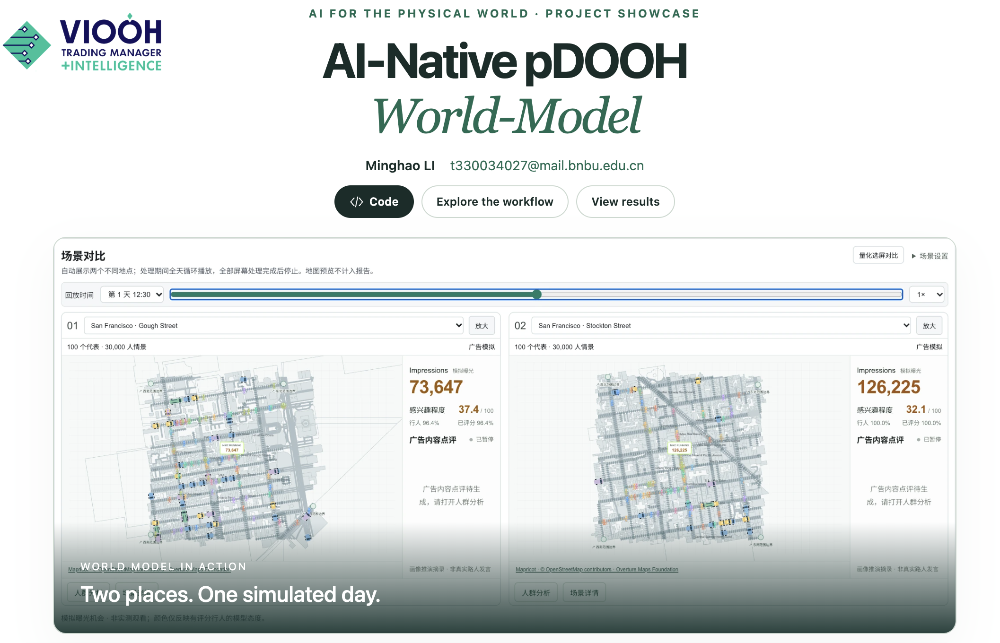
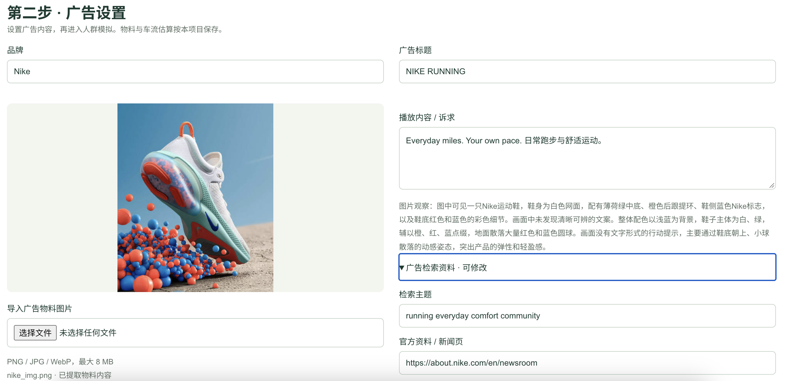
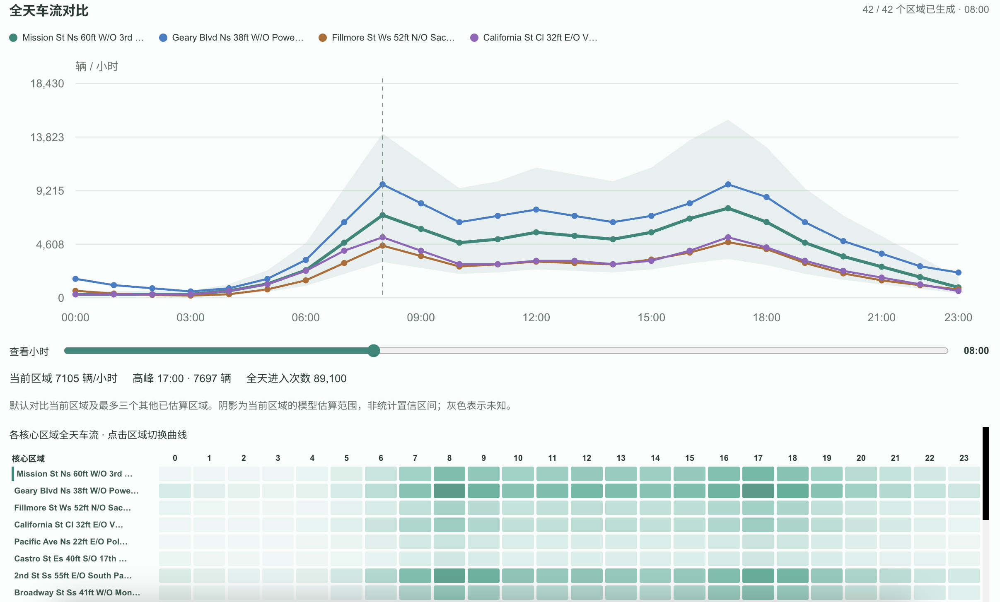
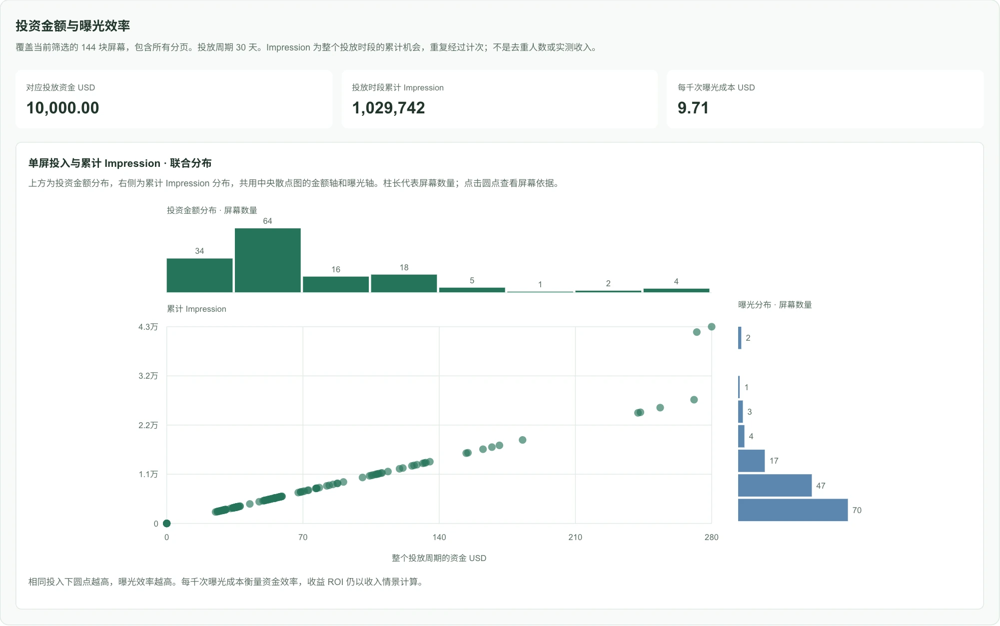

<div align="center">

# 🇺🇸 🇬🇧 VIOOH AI-Native pDOOH World-Model Platform

**A workspace for full-day audience simulation, screen-level investment analysis, and media proposals**

Minghao LI · [t330034027@mail.bnbu.edu.cn](mailto:t330034027@mail.bnbu.edu.cn) (BNBU)

[Business Workflow](#2-four-stage-business-workflow) · [Calculation Methods](#4-core-metrics-and-mathematical-models) · [Deployment](#6-installation-configuration-and-operation) · [APIs and Acceptance](#7-apis-deliverables-and-acceptance)

  

</div>

Plan pDOOH campaigns from inventory to screen-level investment: **configure → simulate → compare → export**.

### Campaign setup



### Road traffic simulation



## 1. Product Scope and Business Applications

| Business task | Deliverable |
| --- | --- |
| Evaluate screen inventory | Validated locations, prices, and eligibility |
| Assess audience opportunities | Full-day simulation and creative-response scores |
| Compare spending priorities | Four allocation plans with maps and charts |
| Prepare a buying proposal | Per-screen SOT, campaign costs, cumulative impressions, and Excel export |

**Scope:** planning and scenario analysis. The application does not place DSP orders or provide measured advertising attribution.

## 2. Four-Stage Business Workflow

| Stage | Action | Output |
| --- | --- | --- |
| **1. Data and settings** | Import Excel; set budget, currency, dates, fees, and exchange rates | Validated project inventory |
| **2. Campaign setup** | Save creative, audience context, and traffic assumptions | Inputs bound to the simulation batch |
| **3. Audience simulation** | Run all screens through a 24-hour schedule | `x / N` progress and two-scene playback |
| **4. Reports and recommendations** | Compare strategies and export the selected plan | Investment map, scorecards, and Excel proposal |

- Start at `/planning`; use `data/test.xlsx` for a trial.
- Reports unlock only when **all screens in the current batch** have complete evidence. Playback at `23:59` alone does not indicate completion.
- Changing campaign inputs can require a new batch. Screen tables display **five records per page**.

## 3. Input Contracts, Data Sources, and Traceability

Import an `.xlsx` worksheet named `FilteredFrames` or `filtered_frames`.

| Field | Meaning |
| --- | --- |
| `VIOOH_ID` | Unique screen identifier; duplicate identifiers are excluded from allocation |
| `GEOM` or `LATITUDE`, `LONGITUDE` | WGS84 location; geometry uses `POINT(longitude latitude)` |
| `ADDRESS_*`, `CLOSEST_POI`, `VENUE_TAXONOMY_VALUE` | Address and venue context |
| `IMPRESSIONS` | Inventory volume with an explicitly defined measurement period |
| `FLOORCPM`, `MEDIAOWNERCURRENCY` | Media CPM and source currency |
| `VIOOHSELECTOPTIN` | Sale eligibility |
| `FRAMEIMAGEPATH` | Site-image reference |

Original records, simulation observations, and commercial estimates remain distinct. Reports retain campaign identifiers, batch identifiers, and evidence fingerprints. Runtime projects and scenes are stored under `backend/uploads/` and excluded from Git.

## 4. Core Metrics and Mathematical Models

Let $s$ denote a screen, $D$ campaign days, $\alpha_s$ SOT, and $B$ budget.

### Cumulative impressions

$$
O_s=\sum_{e\in\mathcal E_s}w_e,\qquad
\widehat I_s=O_s\frac{24}{H_s}D\alpha_s.
$$

$O_s$ is the weighted opportunity count over $H_s$ simulated hours. $\widehat I_s$ covers the **entire campaign period**, including SOT; do not multiply it by days again. Repeated encounters are included, so this is not deduplicated reach.

### Investment and daily amount

$$
c_s=c_s^0(1+m)\frac{r_s}{r_B},\qquad
M_s=\frac{\widehat I_s}{1000}c_s,\qquad
A_s\approx M_s(1+\delta),\qquad
\overline A_s=\frac{A_s}{D}.
$$

| Symbol | Definition |
| --- | --- |
| $c_s^0$, $m$ | Original CPM and markup |
| $r_s$, $r_B$ | USD per unit of media and budget currency |
| $M_s$, $\delta$ | Media spending and DSP fee rate |
| $A_s$, $\overline A_s$ | Total media investment including DSP, and its daily average |

Amounts are rounded in cents. Execution costs are separate; the daily average is not a supplier-guaranteed rental price.

**Example:** 200,000 daily opportunities × 30 days × 0.2% SOT = **12,000 impressions**. At USD 10 CPM plus 10% DSP fees: **USD 132 total**, or **USD 4.40 per day**.

### Scoring and allocation constraints

$$
S_s=\sum_{k=1}^{7}\omega_k z_{s,k},\qquad
\sum_k\omega_k=1,\quad z_{s,k}\in[0,100].
$$

The seven dimensions are exposure, favorability, interest, visibility, location, market fit, and cost. Missing dimensions use a neutral ranking prior, not a measured score.

$$
0\le A_s\le\min\{\alpha_{\max}C_s^{\mathrm{full}},\max(0,\rho B-E_s)\},\qquad
\sum_s A_s+\sum_{s:A_s>0}E_s\le B.
$$

$C_s^{\mathrm{full}}$ is full-SOT campaign cost, $\rho$ the per-screen budget limit, and $E_s$ execution cost. The allocator seeds eligible screens, then redistributes funds by score, cost, and regional concentration. It is a constrained heuristic; unused budget is possible.

### Exposure efficiency and financial scenarios

$$
\operatorname{CPM}_{\mathrm{plan}}=1000\frac{\sum_s A_s}{\sum_s\widehat I_s},\qquad
\Delta R=V\sum_s\frac{\widehat I_s}{1000}r_s^{\mathrm{orders}}\gamma,\qquad
\operatorname{ROI}=\frac{\mu\Delta R-C}{C}.
$$

Financial scenarios require order value $V$, orders per thousand impressions $r_s^{\mathrm{orders}}$, incrementality $\gamma$, margin $\mu$, and total cost $C$. Demonstration assumptions are **not measured returns**. Exposure efficiency alone does not establish revenue ROI.

## 5. Investment Strategies, Visualizations, and an Application Example

| Strategy | Allocation emphasis |
| --- | --- |
| Integrated recommendation | Seven-dimensional score and commercial constraints |
| Exposure efficiency | Exposure 70%, cost 30% |
| Audience interest | Interest 65%, favorability 25%, market fit 10% |
| Regional dispersion | Location 50%, exposure 30%, visibility 20%; stronger concentration penalty |

Strategies reuse the same simulation evidence. Switching priorities updates allocations and charts without rerunning the day.



**Saved example:** 144 screens simulated, USD 10,000 budget, 30 days; 139 funded screens and 139 screens with direct attitude scores. No calibrated revenue-return evidence.

| Strategy | Investment including DSP (USD) | Cumulative impressions | Weighted CPM (USD) |
| --- | ---: | ---: | ---: |
| Integrated recommendation | 10,000.00 | 1,029,742 | 9.71 |
| Exposure efficiency | 10,000.00 | 1,014,841 | 9.85 |
| Audience interest | 10,000.00 | 1,000,774 | 9.99 |
| Regional dispersion | 10,000.00 | 1,030,606 | 9.70 |

[Snapshot data](project-page/dist/assets/results.json). These are simulated planning results; strategy names do not guarantee an optimum. A fresh clone does not include the saved backend jobs.

## 6. Installation, Configuration, and Operation

**Stack:** Vue 3, Vite, MapLibre, Flask, and Python simulation workers. Use **Python 3.11–3.12** and **Node.js 22.12+**.

```bash
git clone https://github.com/SuleynanAuir/AI-Native-pDOOH-Worlds-Model.git
cd AI-Native-pDOOH-Worlds-Model
cp .env.example .env
python3.11 -m venv .venv
.venv/bin/python -m pip install -r backend/requirements-planning.txt
npm ci --prefix frontend
```

Configure `.env` with your model and map services:

```dotenv
LLM_API_KEY=<your-model-service-key>
LLM_BASE_URL=<compatible-api-base-url>
LLM_MODEL_NAME=<available-text-model>
MULTIMODAL_ENABLED=true
MULTIMODAL_VISION_API_KEY=<your-vision-service-key>
MULTIMODAL_VISION_BASE_URL=<vision-api-base-url>
MULTIMODAL_VISION_MODEL=<image-capable-model>
MULTIMODAL_VISION_API_STYLE=chat
LOCATION_PROVIDER=mapricot
MAPRICOT_API_KEY=<your-map-service-key>
LOCATION_LOOKUP_ENABLED=true
PDOOH_POLICY_SIMULATION=true
```

Keep credentials server-side. Policy mode uses the backend Python environment; it does not require the optional OASIS worker.

```bash
# Terminal 1: backend
.venv/bin/python backend/run.py

# Terminal 2: frontend
npm --prefix frontend run dev

# Health check
curl http://127.0.0.1:5001/health
```

Open `/planning` at the frontend URL printed by Vite, normally `http://localhost:3000/planning`. The development API proxy targets port `5001`.

```bash
# Optional standalone project showcase
python3 -m http.server 4178 --bind 127.0.0.1 --directory project-page/dist
```

## 7. APIs, Deliverables, and Acceptance

Paths below are relative to `/api/planning`.

| Method and path | Purpose |
| --- | --- |
| `POST /import` | Upload Excel through multipart field `workbook` |
| `POST /sample` | Create a sample project |
| `GET /<pid>` | Read project and report |
| `GET/POST /<pid>/ad-setup` | Read or save campaign settings |
| `POST /<pid>/creative` | Upload creative |
| `GET/POST /<pid>/coverage` | Inspect or start full-inventory processing |
| `POST /<pid>/plan` | Validate coverage and generate plans |
| `GET /<pid>/export?strategy=investment` | Export a strategy to Excel |

**Excel:** `Proposal` follows the selected strategy. Investment rankings and return scenarios describe the integrated strategy; reconcile each worksheet against its own plan.

**Acceptance checks:** valid inventory → all screens complete 24 rounds in the current batch → budget and SOT limits hold → selected strategy matches its Excel Proposal.

```bash
npm --prefix frontend run build
PYTHONPATH=backend .venv/bin/python -m pytest \
  backend/tests/test_investment.py \
  backend/tests/test_policy_simulation.py \
  backend/tests/test_coverage_parallel.py \
  backend/tests/test_simulation_workflow.py -q
```

Live model, map, and full-inventory execution require separate end-to-end verification.

## 8. Performance, Operations, and Business Validation

**Fast simulation:** batch-generate representative policies, then evolve 24 hours locally. Route caching and parallel screen tasks reduce repeated work; map queries and creative analysis still contribute to total runtime.

| Symptom | First check |
| --- | --- |
| `Network Error` | Backend health and frontend API proxy |
| Missing basemap | Map credentials, tile requests, and connectivity |
| Progress stalls | Worker errors, model rate limits, and map failures |
| Report remains disabled | Current batch completeness, not playback time |
| Very small SOT | Percentage precision and supplier minimum buying shares |

Before buying, confirm inventory availability, prices, visibility, and purchasable SOT. Validate campaign outcomes with delivery records and suitable controls. External deployment needs authentication, TLS, process management, and persistent backups.

| Implementation | Entry point |
| --- | --- |
| Inventory validation | [planning.py](backend/app/audience/planning.py) |
| Reports and strategy comparison | [investment.py](backend/app/audience/investment.py) |
| Budget allocation | [investment_allocation.py](backend/app/audience/investment_allocation.py) |
| Behavioral policies | [policy_simulation.py](backend/app/audience/policy_simulation.py) |
| Batch validation | [simulation_workflow.py](backend/app/audience/simulation_workflow.py) |
| Four-stage UI | [ScreenPlanning.vue](frontend/src/views/ScreenPlanning.vue) |

**License:** root [LICENSE](LICENSE) specifies MIT; historical package metadata contains differing fields. Reconcile these before distribution. Third-party maps, models, data, and brand assets retain their own terms.
